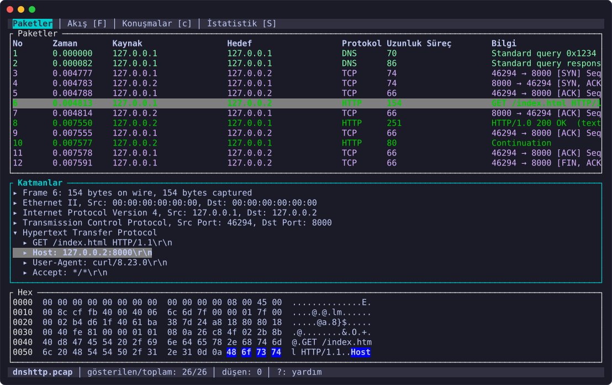
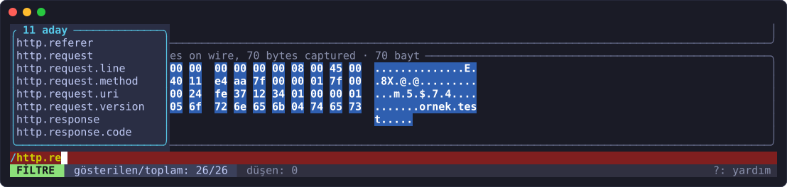
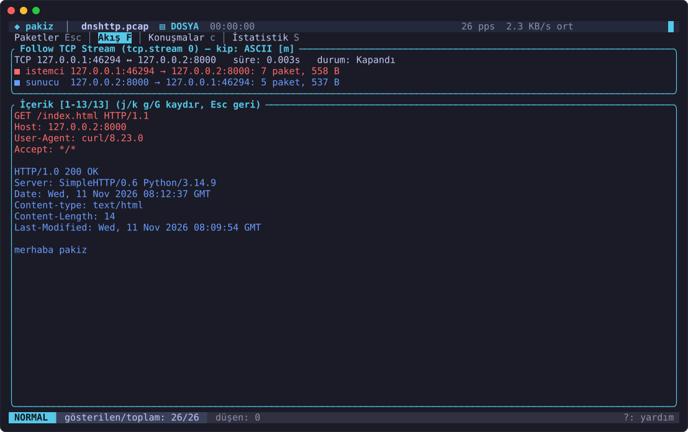
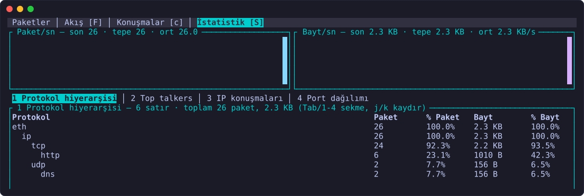
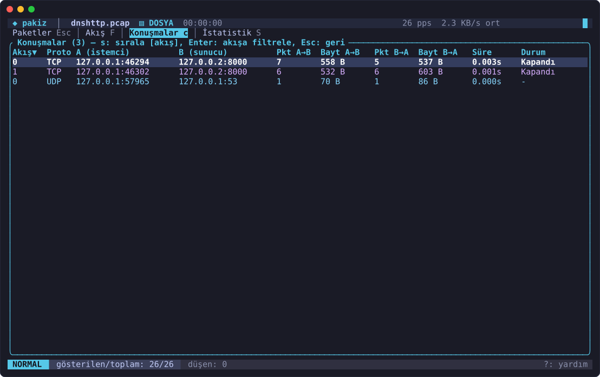
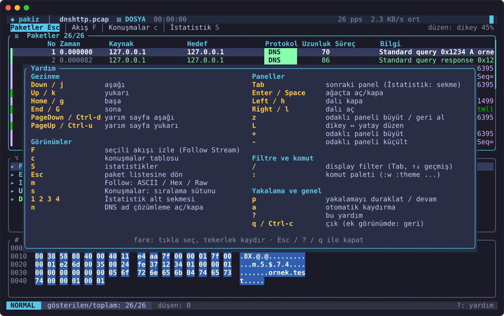
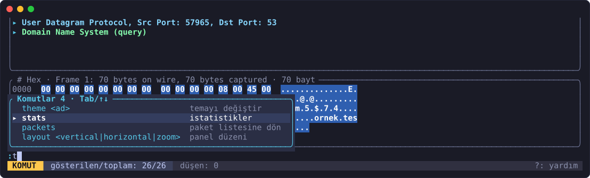
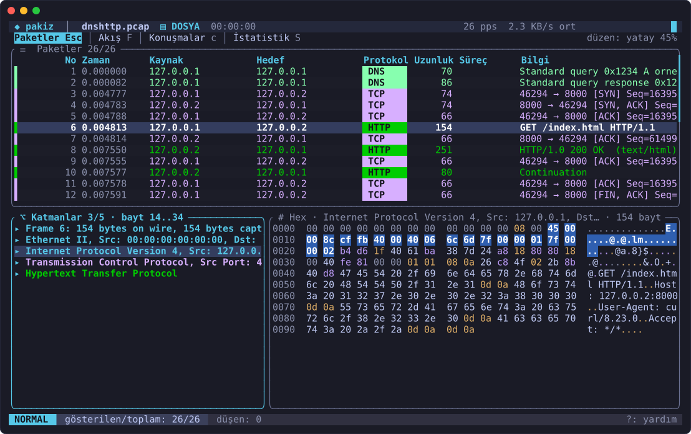
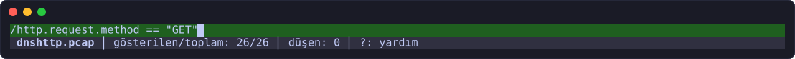
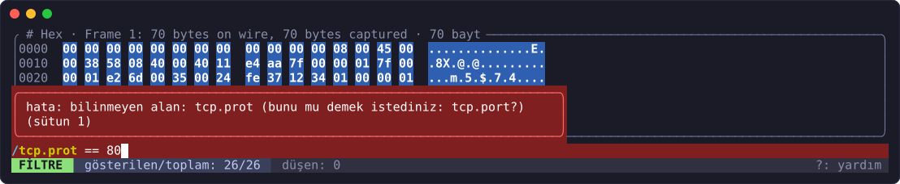

# pakiz

Linux için terminalde çalışan, libpcap'siz, Wireshark benzeri paket analizörü.

[](https://github.com/Shidori5417/pakiz/actions/workflows/ci.yml)




Yakalama doğrudan `AF_PACKET` soketi ve `TPACKET_V3` mmap halkasıyla yapılır;
arayüz ratatui ile çizilir. Çalışma zamanında libpcap gerekmez.

## Özellikler

- **Canlı yakalama**: `AF_PACKET` + `TPACKET_V3` (kullanılamazsa `recvfrom`),
  promiscuous mod, kernel düşen paket sayaçları, kernel'de klasik BPF yakalama
  filtresi (`-f`, `SO_ATTACH_FILTER`).
- **Dosya**: pcap ve pcapng okuma/yazma; büyük dosyalar indekslenir, paketler
  gerektiğinde diskten okunur.
- **Protokoller**: Ethernet, 802.1Q VLAN, ARP, IPv4, IPv6, ICMP, ICMPv6, TCP, UDP,
  DNS (UDP/TCP), mDNS, DHCP, NTP, HTTP/1.x, TLS (el sıkışma, SNI), QUIC (başlık ve
  Initial), SSH (sürüm, KEXINIT), MQTT.
- **Display filter** (`-Y`, TUI'de `/`): Wireshark sözdizimi, yazarken doğrulama,
  Tab ile tamamlama, bilinmeyen alana en yakın ad önerisi.
- **Akış analizi**: TCP yeniden birleştirme, `tcp.analysis.*` uyarıları
  (retransmission, dup ACK, out-of-order, zero window, kayıp segment),
  `tcp.stream` / `udp.stream`, Follow Stream (ASCII / Hex / Raw).
- **İstatistik**: pps/bps grafiği, protokol hiyerarşisi, top talkers, konuşma ve
  port tabloları, DNS cevaplarından ad çözümleme, canlıda paketin yerel süreci
  (sock_diag, olmazsa `/proc`).
- **TUI**: üç panel (liste / katman ağacı / hex), vim tuşları, fare, sanal kaydırma,
  halka tampon, dört yerleşik tema (dark, light, ocean, forest; `:theme` ile
  çalışırken değişir), üst başlık çubuğu ve sekmeler, protokol rozetli liste,
  durum çubuğu, geçici bildirimler, komut paleti, config'ten üretilen yardım
  penceresi, panel büyütme / yatay düzen, config'ten tuş ve renklendirme kuralları.
- **TUI'siz kullanım**: `--no-tui` satır çıktısı, `--count` sayaç modu, `--stats`
  özet; `-r a.pcap -Y ... -w b.pcapng` ile süzerek dönüştürme.

## Ekran görüntüleri

| Display filter: Tab ile tamamlama | Follow Stream (`F`) |
|---|---|
|  |  |
| **İstatistik (`S`)**: eksenli pps/bps grafiği, tablolar, protokol dağılımı | **Konuşmalar (`c`)** |
|  |  |
| **Yardım (`?`)**: tuşlar gerçek keymap'ten (config atamaları dahil) | **Komut paleti (`:`)**: aday listesi, Tab / ↑↓ |
|  |  |

**Yatay düzen (`L`)**: liste üstte, katman ağacı ve hex yan yana.



<details>
<summary>Filtre satırı: geçerli (yeşil) ve hatalı (kırmızı) durum</summary>





</details>

Görseller örnek bir loopback yakalamasından (DNS + HTTP) gerçek TUI çıktısıyla
üretilmiştir.

## Kurulum

Rust stable (2021 edition) gerekir. `cap_net_raw` soket açmak, `cap_net_admin`
promiscuous mod için gereklidir; yetki yoksa program çalıştırılacak komutu söyler.

**Seçenek A (önerilen): `cargo install`.** Binary `~/.cargo/bin/pakiz` olur ve
dizinden bağımsız çalışır.

```sh
cargo install --path crates/bin
# Canlı yakalama için root yerine yetenek (capability) ver:
sudo setcap cap_net_raw,cap_net_admin=eip "$(command -v pakiz)"   # bash/zsh
sudo setcap cap_net_raw,cap_net_admin=eip (command -v pakiz)      # fish
pakiz -i enp6s0
```

> **fish notu:** `~/.cargo/bin` PATH'te değilse `command -v pakiz` boş döner ve
> `setcap` kullanım hatası verir. Bir kez `fish_add_path ~/.cargo/bin` çalıştırın
> ya da mutlak yolu verin:
> `sudo setcap cap_net_raw,cap_net_admin=eip ~/.cargo/bin/pakiz`

**Seçenek B: yerel derleme.** Komutlar proje kökünde çalıştırılmalıdır
(`target/release/...` göreli bir yoldur); başka dizinden mutlak yol kullanın.

```sh
cd /proje/kökü
cargo build --release
sudo setcap cap_net_raw,cap_net_admin=eip target/release/pakiz
./target/release/pakiz -i enp6s0
```

Dosya değişince capability silinir; her yeniden derleme/kurulumdan sonra `setcap`
komutunu tekrar verin.

## Hızlı başlangıç

```sh
pakiz                                   # arayüz seçtirir, canlı TUI
pakiz -i eth0                           # eth0'da canlı TUI
pakiz -i eth0 -f 'udp port 53'          # kernel'de yalnız DNS yakala
pakiz -i eth0 -Y 'tcp.port == 443'      # TUI'yi bir filtreyle başlat
pakiz -i wlan0 -w out.pcapng            # TUI + dosyaya yaz
pakiz -r yakalama.pcap                  # dosyayı TUI'de aç
pakiz -r yakalama.pcap --no-tui -Y dns  # satır çıktısı, yalnız DNS
pakiz -r a.pcap -Y http -w b.pcapng     # süz ve pcapng'ye dönüştür
pakiz -r a.pcap --stats                 # protokol dağılımı + top talkers
pakiz -i eth0 --count                   # her saniye toplam paket/bayt/düşen sayacı
pakiz --list-interfaces
pakiz --theme ocean                     # yerleşik tema (dark, light, ocean, forest)
pakiz --dump-config > ~/.config/pakiz/config.toml
```

<details>
<summary>Tüm bayraklar</summary>

| Bayrak | Açıklama |
|---|---|
| `-i, --interface <ARAYÜZ>` | Yakalanacak arayüz (yoksa `general.default_interface`; TUI'de o da yoksa seçim ekranı açılır, `--no-tui` ve `--count`'ta hata verir) |
| `-r, --read <DOSYA>` | pcap/pcapng dosyasından oku |
| `-w, --write <DOSYA>` | Dosyaya yaz (`.pcapng` uzantısı → pcapng, diğerleri pcap) |
| `-f, --capture-filter <FİLTRE>` | Kernel BPF yakalama filtresi |
| `-Y, --display-filter <FİLTRE>` | Display filter |
| `--list-interfaces` | Arayüzleri listele ve çık |
| `--no-tui` | TUI yerine satır çıktısı |
| `--count` | Ham sayaç modu |
| `--stats` | Sonda özet istatistik |
| `-n, --resolve` | DNS'ten öğrenilen adları göster |
| `--max-packets <N>` | Bellekte tutulacak en fazla paket |
| `--theme <AD>` | `dark`, `light`, `ocean` veya `forest` |
| `--config <YOL>` | Başka bir config dosyası |
| `--dump-config` | Varsayılan config'i yaz ve çık |
| `--no-promisc`, `--force-recv` | Promiscuous modu kapat / mmap yerine `recvfrom` |

Komut satırı bayrakları config dosyasındaki değerleri ezer. `-h` yardım, `-V`
sürüm gösterir.

</details>

## Tuşlar (varsayılan)

| Tuş | Eylem (`[keys]` adı) |
|---|---|
| `j` / `↓`, `k` / `↑` | aşağı / yukarı (`down`, `up`) |
| `g` / `Home`, `G` / `End` | başa / sona (`top`, `bottom`) |
| `Ctrl-d` / `PageDown`, `Ctrl-u` / `PageUp` | yarım sayfa (`half_page_down`, `half_page_up`) |
| `Tab` | panel odağı (`next_panel`) |
| `Enter` / `Space` | ağaçta aç/kapa (`toggle`) |
| `h` / `←`, `l` / `→` | kapa / aç (`collapse`, `expand`) |
| `/` | display filter (Tab tamamlar, ↑/↓ geçmiş) (`filter`) |
| `:` | komut paleti: `:q`, `:w dosya`, `:follow`, `:conv`, `:stats`, `:packets`, `:theme <ad>`, `:layout <vertical\|horizontal\|zoom>`, `:icons <unicode\|nerd\|ascii>`; yazdıkça aday listesi süzülür, Tab tamamlar, ↑/↓ seçer (`command`) |
| `z` | odaklı paneli büyüt / geri al (`zoom`) |
| `L` | dikey ↔ yatay düzen: liste üstte, ağaç \| hex yan yana (`toggle_layout`) |
| `+` / `-` | odaklı paneli büyüt / küçült, liste payı %15..%75 (`grow`, `shrink`) |
| `p` | duraklat / devam (`pause`) |
| `a` | otomatik kaydırma (`autoscroll`) |
| `F` | seçili akışı izle, Follow Stream (`follow`) |
| `c` | konuşmalar (`conversations`) |
| `S` | istatistikler (`statistics`) |
| `n` | DNS ad çözümleme aç/kapa (`toggle_resolve`) |
| `m` | Follow: ASCII / Hex / Raw (`cycle_mode`) |
| `s` | Konuşmalar: sıralama sütunu (`sort`) |
| `1`-`4` | İstatistik alt sekmesi (`tab1`..`tab4`) |
| `Esc` | görünümden geri (`back`) |
| `?` | yardım; `Esc`, `?` veya `q` kapatır (`help`) |
| `q` / `Ctrl-c` | çıkış; ek görünümdeyken geri (`quit`) |
| fare | tıklayınca seçer, tekerlekle kaydırır |

## Filtre dili

Display filter (`-Y`, `/`, `[[coloring]]`):

```text
tcp                                   # alan/protokol varlığı
ip.addr == 10.0.0.1
ip.src == 192.168.0.0/16 and not tcp.port == 22
tcp.port == 80 or tcp.port == 443
tcp.flags.syn == 1 && tcp.flags.ack == 0
dns.qry.name contains "example"
http.request.method == "GET"
tls.handshake.extensions_server_name matches "goog"
eth.addr == aa:bb:cc:dd:ee:ff
tcp.analysis.flags                    # herhangi bir TCP uzman uyarısı
tcp.stream == 3
frame.len > 1000
```

Karşılaştırmalar: `== != > < >= <=` (ve `eq ne gt lt ge le`), `contains`,
`matches` / `~` (regex). Değerler: sayı (`10`, `0x1f`), `"metin"`, IPv4/IPv6
(ağ önekiyle), MAC, `true` / `false`. Mantık: `and` / `&&`, `or` / `||`,
`not` / `!`, parantez. `in {...}` kümesi ve alan dilimleme (`[0:2]`) yoktur. Hatalar sütun işaretiyle gösterilir; bilinmeyen alan adı
için en yakın ad önerilir.

Yakalama filtresi (`-f`, tcpdump alt kümesi, kernel'de klasik BPF):

```text
tcp | udp | icmp | arp | ip | ip6
[src|dst] host 1.2.3.4
[src|dst] port 53
udp port 53                     # yan yana ilkel = örtük and
tcp port 80 and not host 10.0.0.1
(tcp port 80 or tcp port 443) and src host 192.168.1.2
```

## Yapılandırma

Konum: `$XDG_CONFIG_HOME/pakiz/config.toml`, yoksa `~/.config/pakiz/config.toml`.
Dosya yoksa varsayılanlar kullanılır; hatalı config'te program `dosya:satır:sütun`
ile hatayı gösterip çıkar. Tüm seçenekleri içeren yorumlu örnek:
[`docs/config.example.toml`](docs/config.example.toml) (`pakiz --dump-config` ile
aynıdır).

```toml
[general]
default_interface = "wlan0"
max_packets = 200000
fps = 30
resolve_names = true
autoscroll = true
icons = "unicode"       # unicode | nerd (Nerd Font gerekir) | ascii

[theme]
name = "light"          # dark | light | ocean | forest
selection = "#c8d8f0"   # bg, fg, selection, selection_fg, accent, highlight, status, border, border_focus

[theme.protocols]
tcp = "#c8a2ff"         # tcp udp arp icmp dns http malformed other

[keys]
down = ["j", "Down"]    # bir eylemin tüm tuşlarını değiştirir
filter = ["/", "Ctrl-f"]
quit = ["q", "Ctrl-c"]

# Sırayla denenir, ilk eşleşen kazanır; temanın varsayılan kurallarından önce gelir.
[[coloring]]
filter = "tcp.port == 22"
fg = "black"
bg = "#a0d0ff"

[[coloring]]
filter = "dns.flags.rcode != 0"
fg = "red"
```

Tuş yazımı: `j`, `G`, `?`, `Ctrl-d`, `Alt-x`, `Shift-Tab`, `Enter`, `Esc`, `Tab`,
`Space`, `Up`/`Down`/`Left`/`Right`, `Home`, `End`, `PageUp`, `PageDown`,
`Backspace`, `Delete`, `Insert`, `F1`..`F24`. Aynı tuşu config'te iki eyleme
vermek hatadır. Config'teki bir tuş başka bir eylemin *varsayılan* tuşuysa o
eylemden alınır.

Varsayılan renklendirme kuralları (sırayla): kötü TCP (retransmission, dup ACK,
out-of-order, kayıp segment, keep-alive: siyah zemin, kırmızı yazı), sıfır/dolu
pencere, RST, ARP, ICMP/ICMPv6, DNS/mDNS, HTTP/TLS, TCP, UDP. Bu kurallar temanın
protokol renklerini kullanır. Bozuk (malformed) paketler her zaman `malformed`
rengiyle gösterilir.

## Mimari

Cargo workspace: `crates/<ad>` dizinleri, paket adları `pakiz-<ad>`. Ayrıntı:
[`docs/ARCHITECTURE.md`](docs/ARCHITECTURE.md).

| Crate | Sorumluluk |
|---|---|
| `dissect` | `Dissector` trait'i, `Registry`, katman/alan ağacı, tüm protokoller (saf, `unsafe` yok) |
| `capture` | `AF_PACKET`, `TPACKET_V3`, BPF bağlama, arayüz listeleme (`unsafe` olan tek crate) |
| `storage` | pcap / pcapng okuma-yazma, büyük dosya indeksi |
| `filter` | Display filter (lexer, Pratt parser, tamamlama) ve tcpdump alt kümesi → BPF derleyici |
| `flow` | Akış tablosu, TCP birleştirme ve analiz, Follow Stream |
| `stats` | Zaman serisi, protokol hiyerarşisi, konuşmalar, süreç eşleme, DNS önbelleği |
| `tui` | ratatui arayüzü, tuş haritası, tema ve renklendirme kuralları |
| `bin` | `pakiz` binary: CLI, config, çalışma modları |

### Yeni dissector ekleme

Adım adım rehber: [`docs/NEW_DISSECTOR.md`](docs/NEW_DISSECTOR.md).

## Sınırlamalar

- **Şifreli trafik çözülmez**: TLS ve QUIC yükleri deşifre edilmez (anahtar
  günlüğü desteği yoktur). QUIC'te yalnızca açık başlık alanları gösterilir.
- **IP parça birleştirme yok**: IPv4/IPv6 fragment'lar birleştirilmez. Parçalı
  paketlerde üst katman ayrıştırılmaz.
- **TCP birleştirme** Follow Stream ve analiz içindir. HTTP gibi birden çok
  segmente yayılan mesajlar paket listesinde tek PDU olarak birleştirilmez.
- **BPF bir alt kümedir**: yalnızca yukarıdaki ilkeller desteklenir. `host`/`port`
  yalnızca IPv4 içindir, VLAN etiketli çerçeveler eşleşmez, `net`, `portrange`,
  `len`, bayt indeksleme (`tcp[13]`) ve `vlan` yoktur.
- **Süreç eşleme best-effort'tur**: kısa ömürlü bağlantılar, başka ağ ad
  alanları ve konteynerler için süreç bulunamayabilir. Yetki gerekebilir.
- **Ad çözümleme** yalnızca yakalanan DNS cevaplarına dayanır. Ters DNS sorgusu
  yapılmaz.
- **Yalnızca Linux** (`AF_PACKET`) ve yalnızca Ethernet / loopback / cooked olmayan
  bağlantı katmanı. Wi-Fi monitor mode (radiotap) ayrıştırılmaz.
- Dissector'lar port ve içerik sezgisine dayanır. Standart dışı portlardaki
  protokoller tanınmayabilir; "decode as" yoktur.
- `--help` Türkçedir ama clap'in kendi hata mesajları (ör. bilinmeyen bayrak)
  İngilizce kalır.

## Geliştirme

```sh
cargo test --workspace
cargo clippy --workspace --all-targets -- -W clippy::pedantic -D warnings
cargo fmt --check
cargo bench --workspace --no-run
cd crates/dissect && cargo +nightly fuzz run dissect_frame
cd crates/filter  && cargo +nightly fuzz run filter_parse
```

## Lisans

[MIT](LICENSE)
